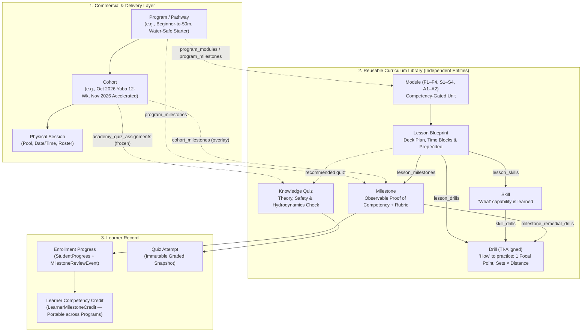

# Academy Independent Curriculum: Milestones, Drills, Lessons, Skills & Quizzes Design

- **Status:** Settled Architecture & Implementation Blueprint
- **Owner:** Founder + Engineering
- **Last Updated:** November 2026
- **Related Decisions:** [`ADR-004`](../DECISIONS.md#adr-004-academy-attendance-defaults-per-student-session-participation--class-consumption), [`ADR-009`](../DECISIONS.md#adr-009-academy-knowledge-quizzes-milestone-evidence--coachadmin-review-overrides), [`ADR-010`](../DECISIONS.md#adr-010-modular-academy-curriculum--stackable-competency-pathways), [`ADR-013`](../DECISIONS.md#adr-013-stroke-lab-ti-coaching-rubric--camera-visibility-honesty)
- **Related Docs:** [`docs/academy/MODULAR_CURRICULUM_PATHWAY.md`](../academy/MODULAR_CURRICULUM_PATHWAY.md), [`docs/design/ACADEMY_ADMIN_CONTROLS_DESIGN.md`](./ACADEMY_ADMIN_CONTROLS_DESIGN.md), [`docs/design/STROKELAB_TI_COACHING_KNOWLEDGE_BANK.md`](./STROKELAB_TI_COACHING_KNOWLEDGE_BANK.md)

---

## 1. Executive Summary & Problem Statement

To operate a world-class, standardized swimming academy across multiple locations (Yaba, Victoria Island, Ago, and future pools) and delivery formats (12-week standard cohorts, 6-week accelerated cohorts, 3–4 week foundation modules, and diagnostic assessment clinics), SwimBuddz needs its curriculum building blocks to be **independent, reusable library entities**.

### What Was Limiting the Legacy Schema
1. **Milestones were hard-locked to a single `Program` (`milestones.program_id NOT NULL`):**
   - A foundational competency like *"Rhythmic Bubble Control"* or *"30-Second Deep-Water Tread & Calm Recovery"* is shared across *Water-Safe Starter*, *Beginner Freestyle: Zero to 50m*, *Accelerated Swimming Programme*, and *Breaststroke Pathway*.
   - Tying a `Milestone` row to a single `program_id` forced admins to duplicate milestones across programs. Worse, when a learner graduated from *Water-Safe Starter* and enrolled in *Beginner-to-50m*, the system could not recognize that they had already passed the foundational milestones.
2. **Cohorts could not customize milestones without mutating the parent Program:**
   - An *Accelerated Cohort* (6 weeks) or a location with a shallow-only pool could not adjust milestone target weeks, add a cohort-specific milestone, or mark an optional milestone without altering every other cohort in that Program.
3. **No first-class `Drills` entity:**
   - Coaches and learners had `Skills` (*what* competency is being learned) and `Lessons` (*weekly class container*), but lacked a structured **Drills Library** (*the exact repeatable in-water exercise, focal point cue, common mistakes, equipment, and set/rep prescription*).
   - When a student failed or struggled with a milestone, coaches had no structured way to prescribe a specific remedial drill video + focal point.
4. **Quizzes were locked to a single `Program` (`academy_quizzes.program_id NOT NULL`):**
   - Core water-safety and hydrodynamic quizzes should be reusable across programs, modules, and lessons while retaining frozen cohort-week snapshots (`AcademyQuizAssignment`, **ADR-009**).

---

## 2. Pedagogical Taxonomy: How Every Concept Fits Together

SwimBuddz separates **Commercial Packaging** (what customers buy) from **Pedagogical Building Blocks** (how coaches teach and how learners progress):



### Clear Definitions
| Entity | Pedagogical Role | Example |
| :--- | :--- | :--- |
| **Module (`AcademyModule`)** | Stackable, competency-gated stage (`F1–F4`, `S1–S4`, `A1–A2`) per `MODULAR_CURRICULUM_PATHWAY.md`. | `F2: Breathing & Bubble Control` (2–3 sessions, requires `F1`). |
| **Lesson (`CurriculumLesson`)** | A single class blueprint (60–120 mins) with a timed Coach Deck Plan, prep video, drills, skills, and target milestones. | `Lesson F2.1: Exhalation Under Water & Bobbing Rhythm`. |
| **Skill (`Skill`)** | **What** biomechanical or safety capability is being acquired. | `Rhythmic Nasal/Mouth Exhalation` (`category: breathing`). |
| **Drill (`AcademyDrill`)** | **How** the swimmer practices the skill in the pool. Includes **one primary focal point** (per **ADR-013** TI doctrine), execution steps, common errors, equipment, demo video, and set prescription. | `Sink-Down Bobs (3 × 10 reps, 15s rest)` — *Focal Point: "Continuous gentle hum through nose until eyes break surface."* |
| **Quiz (`AcademyQuiz`)** | **Cognitive check** testing theory, pool rules, water safety, and hydrodynamic concepts before or after pool time. | `Quiz F2: Why Holding Your Breath Causes Panic & Sinking Hips` (5 MCQs, 80% pass). |
| **Milestone (`Milestone`)** | **Observable proof** that the learner has mastered the competency under a defined rubric and evidence standard. | `Milestone MS-F2-BOBS-20: 20 Continuous Rhythmic Bobs in Chest-Deep Water Without Gasp or Goggle Grab`. |

---

## 3. Database Schema & Entity Design (`academy_service`)

All tables live in `academy_service` and preserve 100% backward compatibility with existing endpoints and records.

### 3.1 Independent Milestones & Multi-Entity Attachments

#### A. Evolving `milestones` into a Canonical Library
`milestones.program_id` becomes **nullable** (`UUID NULL`). Existing rows keep their `program_id` AND are backfilled into `program_milestones`.

New columns on `milestones`:
- `code`: `VARCHAR(64) UNIQUE NULL` — Human-readable canonical identifier (e.g., `MS-F1-SAFE-ENTRY`, `MS-F3-BACK-FLOAT-30S`, `MS-S1-FREE-50M`).
- `category`: `VARCHAR(40) NOT NULL DEFAULT 'skill'` — (`water_safety`, `breathing`, `balance_float`, `streamline_glide`, `propulsion`, `stroke_technique`, `deep_water`, `endurance`).
- `module_code`: `VARCHAR(16) NULL` — Optional canonical module tag (`F1`, `F2`, `F3`, `F4`, `S1`, `S2`, `S3`, `S4`, `A1`, `A2`).
- `is_safety_gate`: `BOOLEAN NOT NULL DEFAULT FALSE` — If `TRUE`, passing this milestone is a mandatory safety prerequisite that cannot be skipped without an explicit coach/admin safety sign-off.
- `is_reusable`: `BOOLEAN NOT NULL DEFAULT TRUE` — Whether this milestone appears in the global Academy Milestone Library for attachment to other programs/cohorts.
- `is_archived`: `BOOLEAN NOT NULL DEFAULT FALSE` — Soft-archive flag so retired milestones are hidden from new assignments without breaking historical `student_progress` FKs.

#### B. `program_milestones` (Program ↔ Milestone Junction)
Defines which canonical milestones belong to a `Program`, in what order, and in which target week.

```sql
CREATE TABLE program_milestones (
    id UUID PRIMARY KEY DEFAULT gen_random_uuid(),
    program_id UUID NOT NULL REFERENCES programs(id) ON DELETE CASCADE,
    milestone_id UUID NOT NULL REFERENCES milestones(id) ON DELETE RESTRICT,
    module_code VARCHAR(16) NULL,
    target_week_number INTEGER NULL,
    order_index INTEGER NOT NULL DEFAULT 0,
    is_required_for_graduation BOOLEAN NOT NULL DEFAULT TRUE,
    weight INTEGER NOT NULL DEFAULT 1,
    notes TEXT NULL,
    created_at TIMESTAMPTZ NOT NULL DEFAULT NOW(),
    updated_at TIMESTAMPTZ NOT NULL DEFAULT NOW(),
    CONSTRAINT uq_program_milestone UNIQUE (program_id, milestone_id)
);
CREATE INDEX ix_program_milestones_program_order ON program_milestones(program_id, order_index);
```

#### C. `cohort_milestones` (Cohort-Specific Overlay / Customization)
Allows any `Cohort` (e.g., an *Accelerated 6-Week Cohort* vs. a *Standard 12-Week Cohort*, or a cohort with custom goals) to attach extra milestones, override target week / graduation requirements, or exclude a program milestone without mutating the parent `Program`.

```sql
CREATE TABLE cohort_milestones (
    id UUID PRIMARY KEY DEFAULT gen_random_uuid(),
    cohort_id UUID NOT NULL REFERENCES cohorts(id) ON DELETE CASCADE,
    milestone_id UUID NOT NULL REFERENCES milestones(id) ON DELETE RESTRICT,
    -- 'include': adds a library milestone or overrides a program milestone's schedule/requirement
    -- 'exclude': removes a program-level milestone from this specific cohort (unless is_safety_gate=true)
    inclusion_mode VARCHAR(16) NOT NULL DEFAULT 'include'
        CONSTRAINT ck_cohort_milestones_mode CHECK (inclusion_mode IN ('include', 'exclude')),
    target_week_number INTEGER NULL,
    order_index INTEGER NULL,
    is_required_for_graduation BOOLEAN NULL,
    notes TEXT NULL,
    created_at TIMESTAMPTZ NOT NULL DEFAULT NOW(),
    updated_at TIMESTAMPTZ NOT NULL DEFAULT NOW(),
    CONSTRAINT uq_cohort_milestone UNIQUE (cohort_id, milestone_id)
);
CREATE INDEX ix_cohort_milestones_cohort ON cohort_milestones(cohort_id);
```

#### D. `lesson_milestones` (Lesson ↔ Milestone Junction)
Connects a `CurriculumLesson` to the milestones introduced, practiced, or assessed during that lesson.

```sql
CREATE TABLE lesson_milestones (
    id UUID PRIMARY KEY DEFAULT gen_random_uuid(),
    lesson_id UUID NOT NULL REFERENCES curriculum_lessons(id) ON DELETE CASCADE,
    milestone_id UUID NOT NULL REFERENCES milestones(id) ON DELETE CASCADE,
    role VARCHAR(24) NOT NULL DEFAULT 'assessed'
        CONSTRAINT ck_lesson_milestones_role CHECK (role IN ('introduced', 'practiced', 'assessed')),
    order_index INTEGER NOT NULL DEFAULT 0,
    created_at TIMESTAMPTZ NOT NULL DEFAULT NOW(),
    CONSTRAINT uq_lesson_milestone UNIQUE (lesson_id, milestone_id)
);
```

---

### 3.2 Portable Learner Competency Ledger (`learner_milestone_credits`)

When a swimmer passes a canonical `Milestone` (whether in an earlier cohort, a standalone module, or a diagnostic assessment), that achievement belongs to the **swimmer (`member_id`)**, not only to a single `enrollment_id`.

```sql
CREATE TABLE learner_milestone_credits (
    id UUID PRIMARY KEY DEFAULT gen_random_uuid(),
    member_id UUID NOT NULL,
    milestone_id UUID NOT NULL REFERENCES milestones(id) ON DELETE RESTRICT,
    status VARCHAR(24) NOT NULL DEFAULT 'achieved'
        CONSTRAINT ck_learner_milestone_credit_status
        CHECK (status IN ('achieved', 'assessed_credit', 'waived', 'expired', 'revoked')),
    source_type VARCHAR(32) NOT NULL
        CONSTRAINT ck_learner_milestone_credit_source
        CHECK (source_type IN ('cohort_enrollment', 'diagnostic_assessment', 'coach_direct', 'admin_override')),
    source_enrollment_id UUID NULL REFERENCES enrollments(id) ON DELETE SET NULL,
    source_progress_id UUID NULL REFERENCES student_progress(id) ON DELETE SET NULL,
    evidence_media_id UUID NULL,
    score INTEGER NULL,
    verified_by_id UUID NULL,
    verified_by_role VARCHAR(20) NULL, -- 'coach' | 'admin'
    notes TEXT NULL,
    achieved_at TIMESTAMPTZ NOT NULL DEFAULT NOW(),
    expires_at TIMESTAMPTZ NULL,
    created_at TIMESTAMPTZ NOT NULL DEFAULT NOW(),
    updated_at TIMESTAMPTZ NOT NULL DEFAULT NOW(),
    CONSTRAINT uq_learner_milestone_credit UNIQUE (member_id, milestone_id)
);
CREATE INDEX ix_learner_milestone_credits_member ON learner_milestone_credits(member_id);
```

#### Synchronization & Portability Invariants
1. **Enrollment → Credit Sync:** Whenever a `StudentProgress` record is marked `achieved` by a coach or admin override, the service upserts `learner_milestone_credits` for `(enrollment.member_id, progress.milestone_id)`.
2. **Revocation Sync:** If an admin or coach overrides a previously `achieved` `StudentProgress` back to `pending`/`rejected`, and `source_progress_id` matches, the credit is updated to `revoked` unless backed by another verified enrollment.
3. **New Enrollment Hydration:** When a learner enrolls in a new cohort (e.g., moving from *Water-Safe Starter* to *Beginner-to-50m*) or views their cohort progress, any milestone in the new cohort that has an active (`achieved` / `assessed_credit`) row in `learner_milestone_credits` is surfaced as **Achieved (Prior Credit)** so the student and coach immediately see what is already mastered.

---

### 3.3 The Drills Library & Prescriptions (`academy_drills`)

Aligned with **ADR-013** (*Stroke Lab Total Immersion Coaching Rubric*), every drill is structured around **Balance → Streamline/Drag → Propulsion** and enforces **one primary focal point at a time**.

```sql
CREATE TABLE academy_drills (
    id UUID PRIMARY KEY DEFAULT gen_random_uuid(),
    code VARCHAR(64) UNIQUE NOT NULL,       -- e.g., 'DRL-TI-SUPERMAN-GLIDE', 'DRL-TI-SKATE'
    name VARCHAR(160) NOT NULL,             -- e.g., 'Superman Glide to Skate Position'
    slug VARCHAR(160) UNIQUE NOT NULL,
    ti_stage VARCHAR(32) NOT NULL           -- 'water_safety' | 'breathing_control' | 'balance_comfort' | 'streamline_drag' | 'propulsion_timing' | 'recovery'
        CONSTRAINT ck_academy_drills_ti_stage
        CHECK (ti_stage IN ('water_safety', 'breathing_control', 'balance_comfort', 'streamline_drag', 'propulsion_timing', 'recovery')),
    stroke VARCHAR(24) NOT NULL DEFAULT 'all'
        CONSTRAINT ck_academy_drills_stroke
        CHECK (stroke IN ('all', 'freestyle', 'breaststroke', 'backstroke', 'butterfly', 'treading')),
    difficulty VARCHAR(24) NOT NULL DEFAULT 'beginner'
        CONSTRAINT ck_academy_drills_difficulty
        CHECK (difficulty IN ('beginner', 'intermediate', 'advanced')),
    summary TEXT NOT NULL,
    -- TI Rule: One primary focal point at a time
    primary_focal_point VARCHAR(240) NOT NULL,
    secondary_focal_points_json JSONB NOT NULL DEFAULT '[]'::jsonb, -- list[str]
    setup_instructions TEXT NULL,
    execution_steps_json JSONB NOT NULL DEFAULT '[]'::jsonb,        -- list[{"step": int, "instruction": str}]
    common_mistakes_json JSONB NOT NULL DEFAULT '[]'::jsonb,        -- list[{"mistake": str, "visible_symptom": str, "correction_cue": str}]
    equipment_json JSONB NOT NULL DEFAULT '[]'::jsonb,              -- list[str], e.g. ["goggles", "fins"]
    default_prescription_json JSONB NOT NULL DEFAULT '{}'::jsonb,   -- {"sets": 4, "distance_m": 12.5, "reps": null, "rest_seconds": 20, "notes": "..."}
    demo_video_media_id UUID NULL,          -- FK to media_service.media_items
    is_published BOOLEAN NOT NULL DEFAULT TRUE,
    created_at TIMESTAMPTZ NOT NULL DEFAULT NOW(),
    updated_at TIMESTAMPTZ NOT NULL DEFAULT NOW()
);
CREATE INDEX ix_academy_drills_stage_stroke ON academy_drills(ti_stage, stroke);
```

#### Drill Junction Tables

1. **`skill_drills` (Skill ↔ Drill Progression):**
   ```sql
   CREATE TABLE skill_drills (
       id UUID PRIMARY KEY DEFAULT gen_random_uuid(),
       skill_id UUID NOT NULL REFERENCES skills(id) ON DELETE CASCADE,
       drill_id UUID NOT NULL REFERENCES academy_drills(id) ON DELETE CASCADE,
       progression_order INTEGER NOT NULL DEFAULT 0,
       CONSTRAINT uq_skill_drill UNIQUE (skill_id, drill_id)
   );
   ```

2. **`lesson_drills` (Lesson Deck Plan ↔ Drill):**
   ```sql
   CREATE TABLE lesson_drills (
       id UUID PRIMARY KEY DEFAULT gen_random_uuid(),
       lesson_id UUID NOT NULL REFERENCES curriculum_lessons(id) ON DELETE CASCADE,
       drill_id UUID NOT NULL REFERENCES academy_drills(id) ON DELETE RESTRICT,
       phase VARCHAR(24) NOT NULL DEFAULT 'main_set'
           CONSTRAINT ck_lesson_drills_phase
           CHECK (phase IN ('warmup', 'main_set', 'cooldown', 'homework')),
       order_index INTEGER NOT NULL DEFAULT 0,
       prescription_override_json JSONB NULL, -- Overrides sets/distance/rest for this specific lesson
       coach_cue_override VARCHAR(240) NULL,  -- Optional lesson-specific focal point cue
       created_at TIMESTAMPTZ NOT NULL DEFAULT NOW(),
       CONSTRAINT uq_lesson_drill_phase UNIQUE (lesson_id, drill_id, phase)
   );
   ```

3. **`milestone_remedial_drills` (Milestone ↔ Remedial Drills):**
   When a learner has not yet passed a milestone (or when a coach rejects a milestone submission with feedback), these linked drills are automatically surfaced to the learner as *"Recommended Practice Drills to Unlock This Milestone"*.
   ```sql
   CREATE TABLE milestone_remedial_drills (
       id UUID PRIMARY KEY DEFAULT gen_random_uuid(),
       milestone_id UUID NOT NULL REFERENCES milestones(id) ON DELETE CASCADE,
       drill_id UUID NOT NULL REFERENCES academy_drills(id) ON DELETE CASCADE,
       priority_order INTEGER NOT NULL DEFAULT 0,
       coach_tip TEXT NULL,
       CONSTRAINT uq_milestone_remedial_drill UNIQUE (milestone_id, drill_id)
   );
   ```

4. **`student_drill_assignments` (Personalized Coach / AI Drill Prescriptions):**
   Allows a coach (during class/review) or Stroke Lab AI to assign a specific drill to an enrolled student with a personalized focal point note.
   ```sql
   CREATE TABLE student_drill_assignments (
       id UUID PRIMARY KEY DEFAULT gen_random_uuid(),
       enrollment_id UUID NOT NULL REFERENCES enrollments(id) ON DELETE CASCADE,
       drill_id UUID NOT NULL REFERENCES academy_drills(id) ON DELETE RESTRICT,
       milestone_id UUID NULL REFERENCES milestones(id) ON DELETE SET NULL,
       assigned_by_id UUID NOT NULL,
       assigned_by_role VARCHAR(20) NOT NULL, -- 'coach' | 'admin' | 'strokelab_ai'
       focal_point_note TEXT NULL,
       prescription_json JSONB NULL,
       status VARCHAR(20) NOT NULL DEFAULT 'assigned'
           CONSTRAINT ck_student_drill_status CHECK (status IN ('assigned', 'practiced', 'mastered', 'archived')),
       completed_at TIMESTAMPTZ NULL,
       created_at TIMESTAMPTZ NOT NULL DEFAULT NOW(),
       updated_at TIMESTAMPTZ NOT NULL DEFAULT NOW()
   );
   CREATE INDEX ix_student_drill_assignments_enrollment ON student_drill_assignments(enrollment_id);
   ```

---

### 3.4 Reusable Quizzes Across Programs, Modules & Lessons

To allow `AcademyQuiz` to be used across multiple programs, modules, and lessons while keeping **ADR-009** invariants intact:
1. **`academy_quizzes.program_id` becomes nullable (`UUID NULL`)**:
   - A quiz with `program_id = NULL` (or `is_reusable = TRUE`) is part of the global Academy Quiz Library.
   - Add `code VARCHAR(64) UNIQUE NULL`, `category VARCHAR(40) NOT NULL DEFAULT 'water_safety'`, `module_code VARCHAR(16) NULL`, `lesson_id UUID NULL REFERENCES curriculum_lessons(id) ON DELETE SET NULL`, and `is_reusable BOOLEAN NOT NULL DEFAULT TRUE`.
2. **`AcademyQuizAssignment` remains the immutable cohort-level contract**:
   - Assigning any library quiz to a cohort week (`cohort_id`, `quiz_id`, `week_number`) continues to freeze `questions_snapshot`, `title_snapshot`, and `quiz_version` (**ADR-009**).

---

## 4. Authoritative Resolution Rules

### 4.1 Resolving the Effective Milestone List for a Cohort
When any endpoint (`GET /cohorts/{id}/milestones`, Coach Scoring Tool, Learner Portal, or Graduation Readiness calculator) requests the milestones for a `Cohort`:

1. **Base Program Set:**
   - Query `program_milestones` for `cohort.program_id` ordered by `order_index`.
   - *Backward-Compatibility Fallback:* Any legacy `Milestone` row with `milestone.program_id == cohort.program_id` that does not yet have a `program_milestones` row is merged automatically.
2. **Apply Cohort Overlays (`cohort_milestones`):**
   - For each `cohort_milestones` row on `cohort.id`:
     - If `inclusion_mode == 'exclude'` and `milestone.is_safety_gate == False`: remove from the effective set. (Safety gate milestones cannot be excluded by a cohort overlay).
     - If `inclusion_mode == 'include'`:
       - If already in the base set, override `target_week_number`, `order_index`, `is_required_for_graduation`, and `notes` where non-null.
       - If not in the base set (e.g., a cohort-specific milestone), append to the effective set.
3. **Sort Deterministically:**
   - Sort by `(target_week_number NULLS LAST, effective_order_index, milestone.name)`.

### 4.2 Resolving Learner Progress (Enrollment + Portable Credit)
For a given `enrollment_id` (`member_id`, `cohort_id`):
1. Resolve the cohort's effective milestone list (Section 4.1).
2. Load `student_progress` rows for `enrollment_id`.
3. Load `learner_milestone_credits` rows for `member_id` where `status IN ('achieved', 'assessed_credit', 'waived')`.
4. For each effective milestone:
   - If `student_progress` exists for this `enrollment_id`, use its status (and if `achieved`, ensure `learner_milestone_credits` is synced).
   - Else if an active `learner_milestone_credits` row exists for `(member_id, milestone_id)`, project status as `achieved` with `credit_source = credit.source_type` (`cohort_enrollment` / `diagnostic_assessment`) so the learner is credited without repeating verified foundational work.
   - Attach `remedial_drills` (from `milestone_remedial_drills`) whenever effective status is `pending` or `rejected`.

---

## 5. Standard SwimBuddz Seed Catalogue (Modules, Drills, Milestones & Quizzes)

To ensure the Academy starts with a cohesive, Total Immersion-informed standard curriculum out of the box, the seed library (`scripts/seed-data/academy/`) will include:

| Module | Canonical Milestones | Core TI / Safety Drills | Knowledge Quiz |
| :--- | :--- | :--- | :--- |
| **F1: Water Confidence & Safety** | `MS-F1-SAFE-ENTRY` (Safe entry/exit), `MS-F1-FACE-SUBMERGE-10S` (Calm 10s face submersion) | `DRL-F1-WALL-WALK`, `DRL-F1-CHIN-TUCK-STAND` (Stand recovery), `DRL-F1-SINK-DOWN` | `QZ-F1-SAFETY`: Pool Depth, Drain/Wall Rules & Calm Recovery |
| **F2: Breathing & Bubble Control** | `MS-F2-RHYTHMIC-BOBS-20` (20 continuous rhythmic bobs) | `DRL-F2-HUMMING-BOBS`, `DRL-F2-SIDE-BREATH-WALL` | `QZ-F2-BREATHING`: CO₂ Reflex & Why Breath-Holding Causes Panic |
| **F3: Floating, Recovery & Body Line** | `MS-F3-BACK-FLOAT-30S` (30s unassisted back float + calm stand), `MS-F3-FRONT-STAR-15S` | `DRL-F3-WEIGHTLESS-HEAD`, `DRL-F3-MUSHROOM-TO-STAR`, `DRL-F3-ROLL-TO-BACK` | `QZ-F3-BUOYANCY`: Center of Buoyancy vs. Center of Mass (See-Saw Principle) |
| **F4: Balance & Streamline Propulsion** | `MS-F4-STREAMLINE-GLIDE-7M` (7m torpedo push-off glide), `MS-F4-FLUTTER-15M` | `DRL-TI-SUPERMAN-GLIDE`, `DRL-TI-TORPEDO-PUSH`, `DRL-F4-BOILING-FEET-KICK` | `QZ-F4-DRAG`: Vessel Shape vs. Engine Power (Why Drag Beats Effort) |
| **S1: Freestyle Foundation** | `MS-S1-FREE-15M-BREATH`, `MS-S1-FREE-25M`, `MS-S1-FREE-50M` | `DRL-TI-SKATE`, `DRL-TI-6-KICK-SWITCH`, `DRL-TI-ZIPPER`, `DRL-TI-SPEAR-SWITCH` | `QZ-S1-FREESTYLE`: Core Rotation, Wide Tracks & Patient Lead Hand |
| **A1: Deep Water Confidence** | `MS-A1-TREAD-60S` (60s calm deep-water tread), `MS-A1-DEEP-JUMP-RECOVER` | `DRL-A1-SCULLING-3-ZONES`, `DRL-A1-EGG-BEATER-INTRO`, `DRL-A1-BACK-FLOAT-REST` | `QZ-A1-DEEP-WATER`: Energy Conservation & Deep-Water Self-Rescue |

---

## 6. API Surface Design (`/api/v1/academy/...`)

### 6.1 Milestone Library & Attachments
- `GET /api/v1/academy/milestones/library` — List/filter canonical library milestones (`?category=`, `?module_code=`, `?is_reusable=true`, `?q=`).
- `POST /api/v1/academy/milestones` — Create a canonical milestone (`program_id` optional; if provided, also creates the `program_milestones` link).
- `PUT /api/v1/academy/programs/{program_id}/milestones` — Attach/reorder canonical milestones on a Program (`program_milestones`).
- `GET /api/v1/academy/cohorts/{cohort_id}/milestones` — Return the **effective** cohort milestone list (Program base + Cohort overlay + remedial drills).
- `PUT /api/v1/academy/cohorts/{cohort_id}/milestones` — Configure cohort-specific milestone overlays (`include` / `exclude` / `target_week_number`).

### 6.2 Drills Library & Prescriptions
- `GET /api/v1/academy/drills` — List/search drills (`?ti_stage=`, `?stroke=`, `?difficulty=`, `?q=`).
- `POST /api/v1/academy/drills` / `PATCH /api/v1/academy/drills/{drill_id}` — Admin CRUD for drills.
- `PUT /api/v1/academy/lessons/{lesson_id}/drills` — Set ordered warmup/main/cooldown/homework drills for a lesson.
- `PUT /api/v1/academy/milestones/{milestone_id}/remedial-drills` — Link remedial drills to a milestone.
- `POST /api/v1/academy/enrollments/{enrollment_id}/drills` — Coach/Admin/AI assigns a personalized drill to a student (`student_drill_assignments`).

### 6.3 Learner Competency Credits
- `GET /api/v1/academy/members/{member_id}/milestone-credits` — List all portable milestone credits earned by a member across cohorts and assessments.
- `POST /api/v1/academy/members/{member_id}/milestone-credits` — Coach/Admin records diagnostic assessment credit (`source_type = 'diagnostic_assessment'`).

---

## 7. Phased Implementation & Migration Plan

### Phase 1: Independent Milestones, Cohort Overlays & Competency Ledger (Backend + DB)
1. **Alembic Migration (`academy_service`):**
   - Alter `milestones.program_id` to `NULLABLE`; add `code`, `category`, `module_code`, `is_safety_gate`, `is_reusable`, `is_archived`.
   - Create `program_milestones`, `cohort_milestones`, `lesson_milestones`, and `learner_milestone_credits`.
   - Data backfill inside migration:
     - Insert a `program_milestones` row for every existing `(milestone.program_id, milestone.id)` pair preserving `order_index`.
     - Backfill `learner_milestone_credits` from all existing `student_progress` rows where `status = 'achieved'`.
2. **Service & Router Updates:**
   - Update program and cohort milestone queries to use the Effective Milestone Resolver (Section 4.1) with legacy fallback.
   - Hook `StudentProgress` achievement / override workflows (`progress.py`, `admin_progress.py`) to auto-sync `learner_milestone_credits`.

### Phase 2: Drills Library, Lesson Deck Plans & Remedial Prescriptions (Backend + DB)
1. **Alembic Migration (`academy_service`):**
   - Create `academy_drills`, `skill_drills`, `lesson_drills`, `milestone_remedial_drills`, and `student_drill_assignments`.
   - Alter `academy_quizzes.program_id` to `NULLABLE`; add `code`, `category`, `module_code`, `lesson_id`, `is_reusable`.
2. **Seed Data & Routers:**
   - Seed canonical TI & water-safety drills (`F1–F4`, `S1`, `A1`) and link them to milestones and skills.
   - Expose Drills CRUD, Lesson Drill assembly, and Student Drill Assignment endpoints.

### Phase 3: Admin Curriculum Studio, Coach Deck & Learner Journey UI (`swimbuddz-frontend`)
1. **Admin Curriculum Studio (`/admin/academy/curriculum` & `/admin/academy/programs/[id]`):**
   - Global Library tabs for **Milestones**, **Drills**, **Skills**, and **Quizzes**.
   - Program builder to attach existing library milestones/quizzes without duplicating rows.
   - Cohort detail tab (**Cohort Milestones & Quizzes**) to configure cohort-specific milestone overlays (`cohort_milestones`) and weekly quiz assignments.
2. **Coach Deck & Review Experience:**
   - Lesson Deck view showing ordered `lesson_drills` with the **Primary Focal Point** highlighted.
   - During milestone review/rejection, 1-click **"Assign Remedial Drill"** to attach a drill directly to the student's dashboard.
3. **Learner Academy Portal (`/account/academy/enrollments/[id]`):**
   - **My Milestones:** Displays effective cohort milestones, badges for **Prior Credit**, and expandable **Recommended Drills** (with focal point & video) on any pending or rejected milestone.
   - **My Assigned Drills & Weekly Prep:** Shows lesson drills and coach-prescribed practice sets alongside weekly knowledge quizzes.
